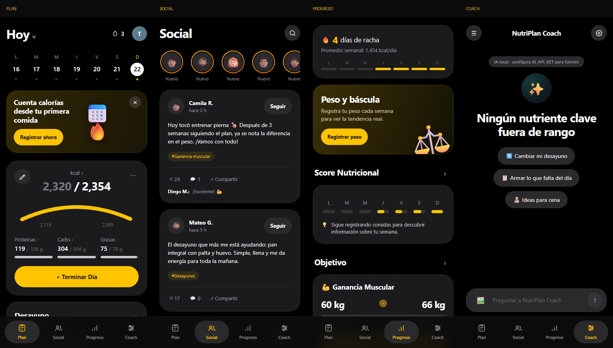

# NutriPlan PWA

PWA de nutrición y seguimiento corporal inspirada en Fitia. Funciona 100% en el navegador, sin backend: los datos se guardan en `localStorage` y la app se puede instalar y usar sin conexión.

## Funciones

- **Plan:** calendario semanal, registro de comidas (desayuno, almuerzo, cena y snacks) desde una base de alimentos, contador de calorías y macronutrientes, control de agua y cierre del día.
- **Progreso:** objetivo de peso con fecha estimada, actualización de peso, score nutricional semanal, gráficas de calorías y peso, fotos del progreso y métricas personalizadas.
- **Social:** feed con publicaciones, me gusta y comentarios.
- **Coach:** asistente contextual que analiza lo que registraste y sugiere cambios, menús y opciones para cenar.
- Instalable (manifest + service worker) y offline.

## Vista previa



Capturas reales generadas con `python scripts/capture.py` contra un servidor local.

## Arrancar

Sirve la carpeta con cualquier servidor estático:

```bash
python -m http.server 8080
```

Abre `http://localhost:8080`. Para instalarla como PWA, usa el menú "Instalar aplicación" del navegador.

## Estructura

```
index.html            # shell de la app
css/styles.css        # sistema visual
js/data.js            # alimentos y estado inicial
js/store.js           # persistencia y cálculos
js/ui.js              # render de pantallas y modales
js/app.js             # eventos y arranque
sw.js                 # caché offline
manifest.webmanifest  # instalación como PWA
```
